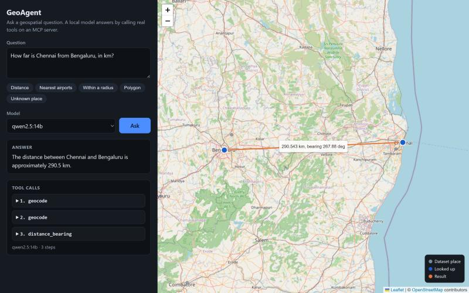
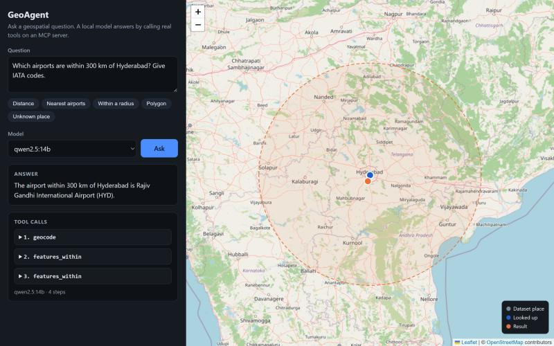

# GeoAgent

An [MCP](https://modelcontextprotocol.io) server that gives LLM agents geospatial tools, plus an eval suite that measures how reliably an agent uses them.

> **Status: v0.2 work in progress.** The tools, the agent loop, the eval runner and first results are real and run. Next: fix what the evals found and measure run-to-run variance. See the [roadmap](#roadmap).

## Why

LLMs are bad at geometry from memory. Ask one for the distance between two cities and it will give a confident, slightly wrong number. GeoAgent gives the model real tools for coordinates, distances and proximity, then **measures** whether it picks the right tool and returns the right answer, instead of hoping.

## Tools

| Tool | What it does |
|---|---|
| `geocode` | Look up a place by name or airport code in the bundled dataset |
| `distance_bearing` | Geodesic distance (WGS84) and bearings between two points |
| `features_within` | Places within a radius of a point, nearest first |
| `nearest_features` | The N nearest places to a point |
| `point_in_polygon` | Point-in-polygon test against a GeoJSON polygon |

Plus one **resource** (`geoagent://catalog`, the dataset) and one **prompt** (`geo_question`, instructions for using the tools carefully).

Planned for v0.2: `elevation_profile` from an open DEM, and a larger dataset (Natural Earth / OpenStreetMap).

## Quick start

```bash
git clone https://github.com/AbishekFRK/geoagent.git
cd geoagent
python -m venv .venv
.venv\Scripts\activate          # Windows. On macOS/Linux: source .venv/bin/activate
pip install -e ".[dev]"
pytest
```

Run the server and try the tools in the MCP inspector:

```bash
npx @modelcontextprotocol/inspector geoagent-server
```

Use it from Claude Desktop or Claude Code by adding it as a stdio server:

```json
{
  "mcpServers": {
    "geoagent": { "command": "geoagent-server" }
  }
}
```

## Ask it a question (no API key needed)

The bundled agent talks to any tool-calling model through the OpenAI-compatible chat API. By default it uses a local [Ollama](https://ollama.com) model, so it is free and private:

```bash
ollama pull qwen2.5:14b
python -m geoagent.agent -v "How far is Chennai from Bengaluru, in km?"
```

`-v` prints every tool call. Pick another model with `--model llama3.1:8b`. To use a hosted provider instead, set `GEOAGENT_BASE_URL`, `GEOAGENT_MODEL` and `GEOAGENT_API_KEY`.

## Web UI

A small local page shows the answer, every tool call, and a map of what the agent found:

```bash
pip install -e ".[web]"
geoagent-web          # then open http://127.0.0.1:8000
```

Pick a model, click an example or type a question. Lookups, distance lines, radius circles, polygons and results are drawn on the map; each tool call can be expanded to show its arguments and raw result.





Notes: the map tiles come from OpenStreetMap, so the map needs an internet connection (the tools and model do not). The server binds to `127.0.0.1` only and has no login, because it can drive your model server; do not expose it to a network.

## Architecture

```
User question
     |
     v
  Agent (any tool-calling LLM)   src/geoagent/agent.py   <- also used by the web UI (web.py)
     |  MCP (stdio)
     v
GeoAgent MCP server  (src/geoagent/server.py)
     |
     v
Pure geo functions   (src/geoagent/geo.py: pyproj, shapely)
     |
     v
Bundled sample dataset (src/geoagent/data/sample_places.csv)
```

The server uses the MCP Python SDK 2.x (`MCPServer`, called `FastMCP` in 1.x). The geospatial logic lives in plain functions in `geo.py` with no MCP dependency, so it is unit-tested directly. `server.py` only wraps them.

## Evals

`evals/cases.jsonl` holds questions with objective ground truth (distances computed independently, known nearest airports, deliberate "ambiguous question" cases). The runner will report two numbers:

- **Tool selection accuracy**: did the agent call the right tools?
- **Answer accuracy**: is the final answer within tolerance of the ground truth?

Run them yourself (needs Ollama with the models pulled):

```bash
python evals/run_evals.py --models qwen2.5:14b llama3.1:8b --markdown evals/RESULTS.md
```

To check how stable a result is, add `--repeats 3` (or more) to run every case several times. The report then shows each model's mean score with the lowest and highest run, and how many runs passed each case.

### Results (18 cases x 3 runs, local models via Ollama, temperature 0, tightened prompt)

| Model | Tool selection | Answer accuracy | Mean time per case |
|---|---|---|---|
| `qwen2.5:14b` | 94% | 100% | 9.3 s |
| `llama3.1:8b` | 83% | 67% | 6.5 s |

**The three runs were identical.** Every case gave the same pass or fail in all three runs for both models, so the min and max of each score equal the mean. With a fixed model, prompt and temperature 0, these results are stable. That also means the failures below are systematic, not bad luck. Per-case pass counts: [evals/RESULTS.md](evals/RESULTS.md).

### Did tightening the prompt help?

After the first results I tightened the system prompt and the tool descriptions (the geocode tool now says it returns coordinates only; the prompt has numbered rules). Because I tuned against the first 11 cases, those cases cannot show whether the change generalises. So I wrote 7 **held-out** cases (`"split": "holdout"` in `cases.jsonl`) before tuning and ran the old prompt on them as a baseline.

| Held-out cases (7) | Tool selection, before | after | Answer accuracy, before | after |
|---|---|---|---|---|
| `qwen2.5:14b` | 100% | 100% | 100% | 100% |
| `llama3.1:8b` | 71% | 86% | 43% | 57% |

Reading this honestly: Qwen was already perfect on the held-out cases, so there was nothing to gain. Its one new tool-selection miss, on the Atlantis case in the main set, was saying the place was not in the dataset without calling `geocode` to check. Llama improved a little on the held-out cases, but 7 cases is too few to call that significant, and across all 18 cases its answer accuracy did not improve: it regressed on the polygon cases and kept inventing places. On the original 11 cases, Qwen's recurring "answers distance from memory" miss is gone.

### What the evals found

- **Qwen 2.5 14B used to skip the distance tool.** For "Mysuru to Bengaluru" it geocoded both places, then answered from memory ("149 km", "152 km") instead of calling `distance_bearing` (true: 127.9 km). It failed this in two runs, passed in an earlier run, and passes it after the prompt change.
- **Llama 3.1 8B invents places and answers.** For ambiguous or unknown places ("the two airports", "Gotham") it still makes up places or coordinates and reports a distance instead of asking, even with explicit rules against it.
- **Llama 3.1 8B sent the polygon as a JSON string**, which the tool rejected. The evals exposed this; the tool now accepts either form. After the prompt change Llama's polygon answers went wrong again for a different reason (it emitted malformed tool calls as text), so small-model reliability here is not just a prompt problem.
- **Llama 3.1 8B often skips `geocode`**, answering nearest/radius questions correctly from remembered coordinates. That counts as a tool-selection miss even when the answer is right.

Caveats: 18 cases is a small sample, so read the percentages as indicative only. The before/after tables above compare single runs from earlier in development; during that work Qwen passed the Mysuru-Bengaluru case once and failed it in the next two runs with the same prompt, which I could not explain (the final 3-run measurement shows no such variation, so it may have been an Ollama state effect). Treat any one-off difference of a single case with suspicion. Answers are scored with deterministic rules (no LLM judge), documented at the top of [evals/run_evals.py](evals/run_evals.py). Boolean answers only count if `point_in_polygon` actually ran, a rule added after a first run showed an error message being misread as a "no".

## Roadmap

- [x] Repo, packaging, 5 tools, resource, prompt, unit tests
- [x] First eval cases and schema checks
- [x] Agent loop (`agent.py`), model-agnostic, tested with a scripted fake model and a real local model
- [x] Eval runner and published results, compared across models (`qwen2.5:14b` vs `llama3.1:8b`)
- [x] Fix what the evals found (the polygon argument now accepts a JSON string) and re-run
- [x] Tighten the prompt and tool descriptions, checked on held-out cases
- [x] Repeat each case 3 times to measure variance (results were identical across runs)
- [ ] Try a stricter tool-call format or a stronger model for the "invents places" failures
- [ ] Repeat each case several times to measure run-to-run variance
- [x] Local web UI: answer, tool-call trail and a map
- [ ] `elevation_profile` and a larger open dataset
- [ ] Demo gif and tagged release

## Data

The bundled `sample_places.csv` is a small hand-made set of Indian cities and airports with approximate coordinates, for demos and tests only. Do not use it for navigation. Larger open datasets are planned.

## License

MIT
